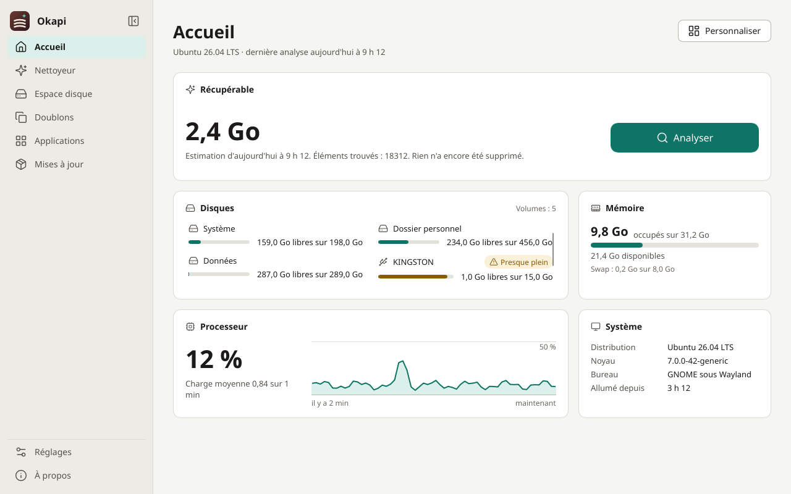
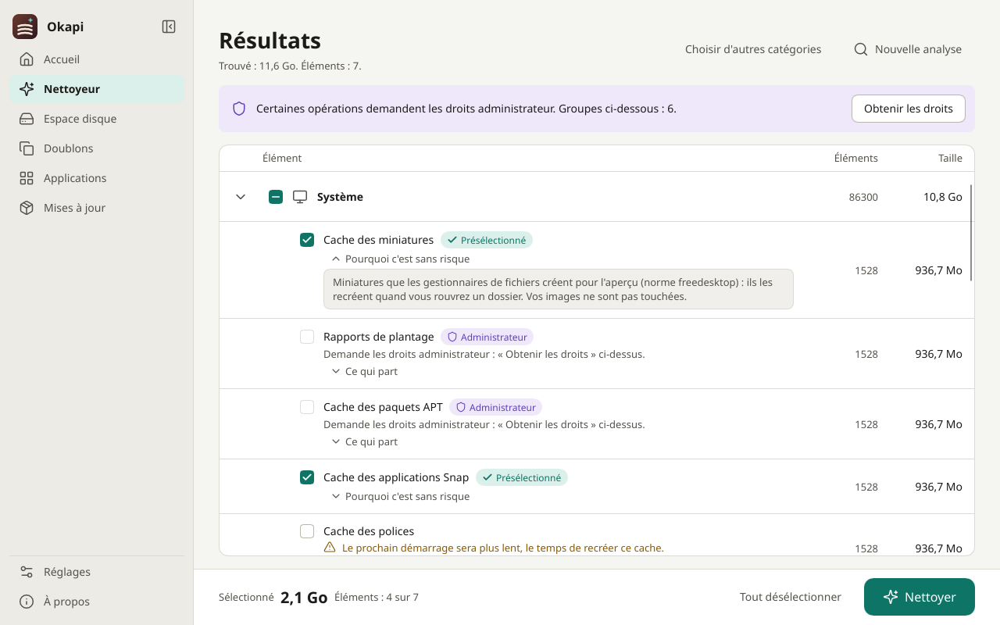
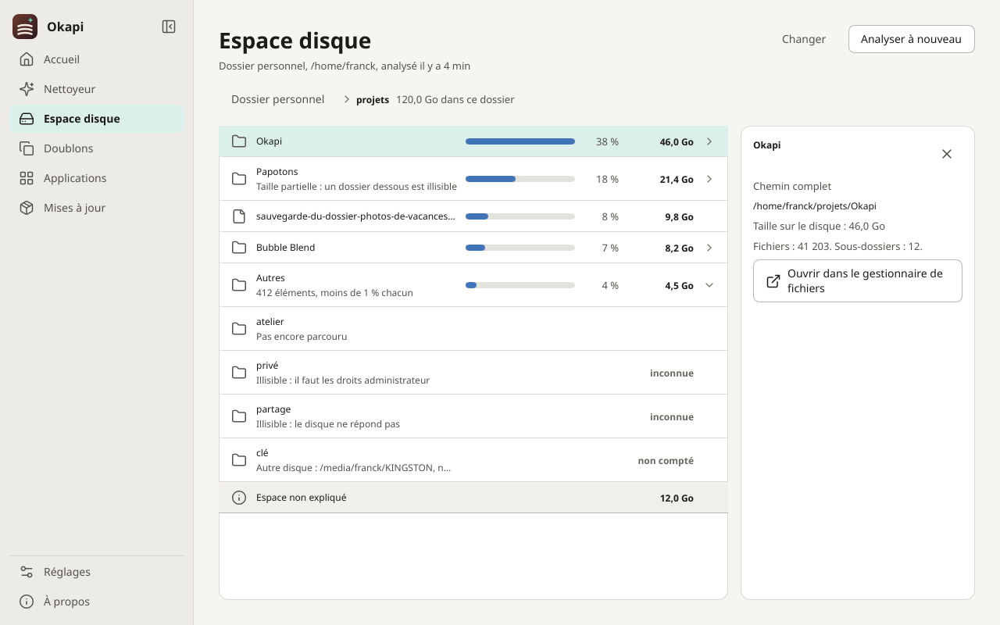
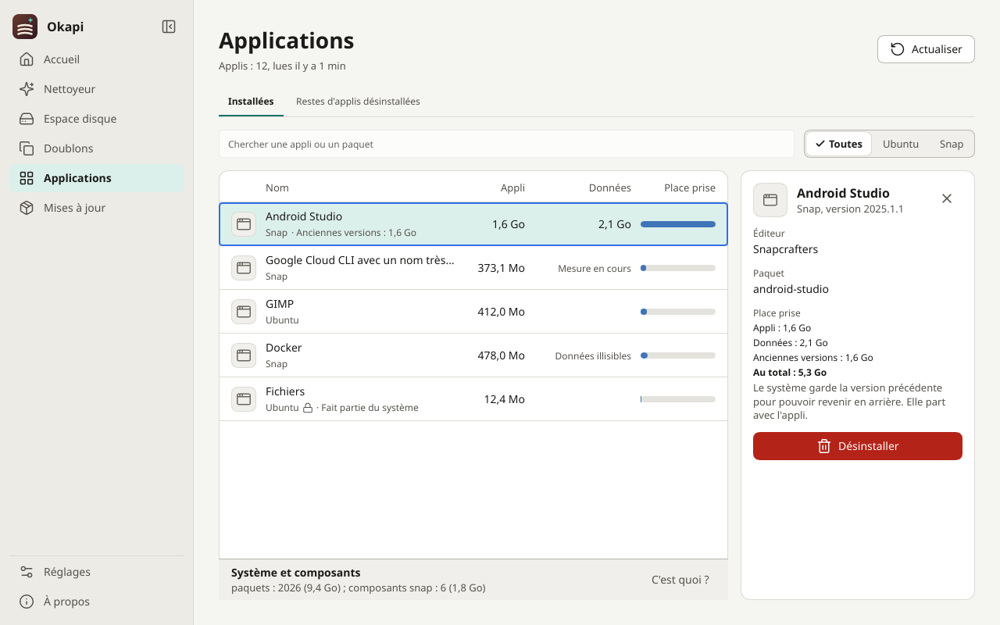
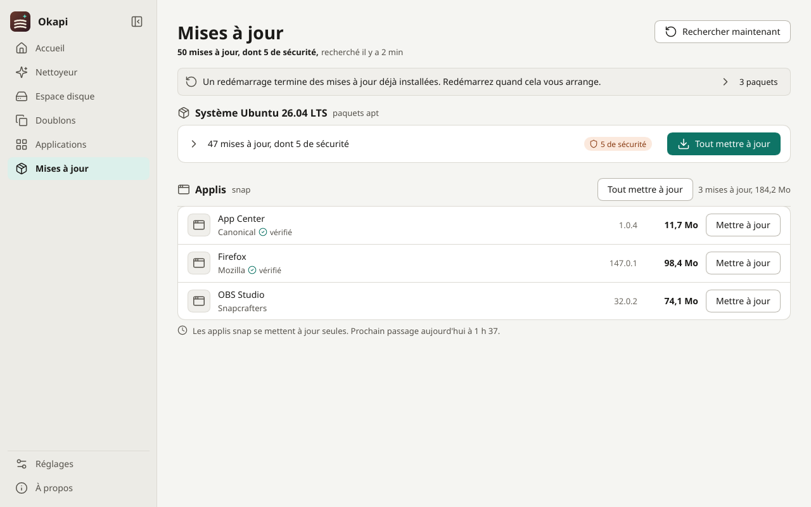

<p align="center">
  
</p>

<h1 align="center">Okapi</h1>

<p align="center">
  <strong>Un nettoyeur et outil d'entretien système natif pour le bureau Linux, écrit en Rust.</strong><br>
  Pas d'Electron, pas de cloud, pas d'appli lancée en root.
</p>

<p align="center">
  <a href="LICENSE"></a>
  
  
  <a href="https://slint.dev"></a>
  
</p>

<p align="center">
  <a href="README.md">English</a> · <strong>Français</strong>
</p>

<p align="center">
  <picture>
    <source media="(prefers-color-scheme: dark)" srcset="assets/screenshots/home-dark.png">
    
  </picture>
</p>

> [!WARNING]
> Okapi est en début de développement (version 0.1.0). Il n'y a pas encore de paquet à installer : on le compile depuis les sources, et il ne tourne que sous Linux pour l'instant. C'est un outil qui supprime des fichiers : lisez ce qu'il vous montre avant de confirmer.

## Ce qu'il fait

| | |
|---|---|
| **Nettoyeur** | Trouve ce que les applications laissent derrière elles (caches, journaux, fichiers temporaires, rapports de plantage) pour le système, les navigateurs basés sur Chromium et Firefox, des dizaines d'applis de bureau et d'outils de développement, les jeux et les caches de shaders. Chaque groupe dit pourquoi on peut le retirer sans risque. |
| **Tableau de bord** | Un écran d'accueil que vous arrangez vous-même : espace récupérable, disques, mémoire, processeur, système. Les widgets se déplacent à la souris ou au clavier. |
| **Espace disque** | Montre ce qui prend de la place, dossier par dossier, et ouvre n'importe lequel dans le gestionnaire de fichiers. |
| **Doublons** | Retrouve les fichiers au contenu identique (BLAKE3) et met à la corbeille les copies que vous choisissez. La dernière copie d'un fichier ne part jamais. |
| **Applications** | Liste les applis installées (deb, snap, flatpak) avec la place que chacune prend vraiment, les désinstalle, et retrouve les dossiers laissés par les applis désinstallées. |
| **Mises à jour** | Montre les mises à jour apt et snap en attente, celles de sécurité signalées, et les installe. |
| **Ligne de commande** | `okapi` analyse et nettoie depuis un terminal ou un script, avec une sortie JSON et des codes de sortie parlants. |

L'interface existe en français et en anglais, en thème clair et sombre, et elle est pensée pour s'utiliser au clavier et avec un lecteur d'écran.

## Captures d'écran

| Nettoyeur | Espace disque |
|---|---|
|  |  |

| Applications | Mises à jour |
|---|---|
|  |  |

## Sûr par construction

Un nettoyeur n'a d'intérêt que si on peut lui faire confiance. Ces règles sont imposées dans le code et couvertes par des tests :

- **Des identifiants, jamais des chemins.** L'interface et la ligne de commande ne transmettent jamais un chemin à supprimer. Elles transmettent des identifiants issus de la dernière analyse, et seule la bibliothèque qui a fait cette analyse sait les relier à des fichiers.
- **Revérifié au dernier moment.** L'âge de chaque élément, descendants compris, est relu juste avant sa suppression. Ce qui a resservi depuis l'analyse reste en place.
- **Aucun lien symbolique n'est suivi**, ni par l'analyse ni par la suppression. Le nettoyage redescend depuis une racine connue par descripteurs de fichiers : un dossier remplacé entre-temps par un lien ne mène nulle part.
- **Vos dossiers importants ne peuvent pas être une cible.** Une racine de suppression n'est jamais votre dossier personnel, votre dossier de configuration ni l'un de leurs parents. Le contrôle se fait par identité de fichier, pas en comparant des noms.
- **Rien de risqué n'est coché à votre place.** Les nettoyages qui ralentissent le prochain démarrage (caches de performance) et les opérations de maintenance restent toujours décochés.
- **Vos fichiers vont à la corbeille.** Les doublons et les restes d'applis sont mis à la corbeille, jamais supprimés, après vérification que le fichier est bien celui de l'analyse. Seuls les caches et autres fichiers que le système recrée, trouvés par le nettoyeur, sont supprimés pour de bon, et la confirmation le dit.
- **Une règle est de la donnée.** Une règle de nettoyage nomme des dossiers et des motifs, jamais une commande, un programme ni un argument.
- **Okapi ne tourne jamais en root.** Le nettoyage des emplacements du système passe par un tout petit programme lancé par `pkexec` sous une politique polkit. Il n'accepte qu'une liste fermée d'opérations et refait lui-même l'analyse au lieu de croire ce qu'on lui dit. L'installation des mises à jour et la désinstallation des applis sont confiées à PackageKit, à snapd et au service système de Flatpak : Okapi ne voit jamais de mot de passe.
- **Tout reste sur votre machine.** Pas de compte, pas de cloud, pas de télémétrie. Les binaires n'embarquent aucun client HTTP : Okapi ne parle qu'à des services locaux (D-Bus, la socket de snapd).

Côté code, `unsafe` est refusé dans tout le workspace et les lints pedantic de Clippy sont la norme.

## Pour commencer

### Prérequis

- Linux. Okapi est développé et essayé sous Ubuntu, avec GNOME sous Wayland. Les autres distributions ne sont pas encore essayées.
- Rust 1.99 ou plus récent.
- Un compilateur C, `pkg-config` et les fichiers de développement de fontconfig. Sous Ubuntu :

```bash
sudo apt install build-essential pkg-config libfontconfig-dev
```

Les écrans Applications et Mises à jour s'appuient sur PackageKit et snapd quand ils sont là. Tout le reste marche sans eux.

### Compiler et lancer

```bash
git clone https://github.com/Cryborg/okapi.git
```

```bash
cd okapi
```

```bash
cargo run --release -p okapi-app
```

### En option : nettoyer les emplacements du système

Certains groupes (le cache des paquets APT, les rapports de plantage...) appartiennent à l'administrateur. Pour les déverrouiller, installez le programme d'aide et sa politique polkit. Lancez le script sous votre compte : il compile, puis ne demande `sudo` que pour deux copies de fichiers.

```bash
packaging/linux/install-helper.sh
```

`packaging/linux/uninstall-helper.sh` retire les deux fichiers.

### En option : lanceur et icône

Ajoute Okapi au menu des applications, pour votre compte seulement. Le lanceur pointe sur la version de développement, dans `target/debug`.

```bash
packaging/linux/install-desktop-entry.sh
```

## Ligne de commande

Compilez le binaire `okapi` une fois :

```bash
cargo build --release -p okapi
```

Analyser et montrer ce qui pourrait partir, sans rien toucher :

```bash
./target/release/okapi
```

Nettoyer les groupes présélectionnés (jamais les réinitialisations de cache, jamais ce qui exige l'administrateur) :

```bash
./target/release/okapi --clean
```

Analyser seulement les navigateurs et les applis, en JSON, pour un script :

```bash
./target/release/okapi --json --browsers --apps
```

`okapi --help` liste toutes les options : les catégories (`--system`, `--browsers`, `--apps`, `--gaming`, `--gpu`), `--exclude`, `--min-age`, `--verbose`, `--quiet`, et les codes de sortie.

Okapi lit ses réglages dans `~/.config/okapi/settings.json` et garde son historique et ses journaux sous `~/.local/state/okapi/`.

## Organisation du code

Un workspace Cargo où l'interface et la ligne de commande sont de fines coquilles au-dessus des bibliothèques :

| Crate | Rôle |
|---|---|
| `okapi-rules` | Les règles de nettoyage, en données : types, variables, validation, textes traduits. |
| `okapi-platform` | Les traits du système d'exploitation (chemins, élévation, corbeille...), un module par OS. |
| `okapi-engine` | Analyse, nettoyage sûr, reçus, progression et annulation. |
| `okapi-store` | Réglages, disposition du tableau de bord, historique, journaux, avec écriture atomique. |
| `okapi-tools` | Un module par outil : espace disque, doublons, applications, mises à jour, relevés du système. |
| `okapi-helper` | Le binaire privilégié lancé par `pkexec`, avec sa liste fermée d'opérations. |
| `okapi` | La ligne de commande. |
| `okapi-app` | L'interface de bureau, faite avec [Slint](https://slint.dev). |

## Feuille de route

Des idées en cours, sans ordre promis :

- Gros fichiers, dossiers vides, programmes lancés au démarrage et services systemd
- Un écran d'historique des nettoyages
- Des nettoyages planifiés
- La santé du disque
- Windows, puis macOS

## Contribuer

Les rapports de bogue et les idées sont bienvenus dans les [issues](https://github.com/Cryborg/okapi/issues), en français ou en anglais. Si Okapi vous a proposé de retirer quelque chose qu'il aurait dû garder, c'est le rapport le plus précieux que vous puissiez faire.

Avant d'ouvrir une pull request :

```bash
cargo test --workspace
```

```bash
cargo clippy --workspace --all-targets -- -D warnings
```

```bash
cargo fmt --all --check
```

Le code et les identifiants sont en anglais. Les textes de l'interface sont écrits en français d'abord, puis traduits en anglais.

## Remerciements

Okapi est inspiré de [Kudu](https://github.com/adventdevinc/kudu) (MIT), dont il reprend et adapte les règles de nettoyage. Le détail est dans [THIRD_PARTY_NOTICES](THIRD_PARTY_NOTICES). Okapi est un projet indépendant, sans lien avec Kudu.

L'interface est faite avec [Slint](https://slint.dev).

## Licence

[MIT](LICENSE)
