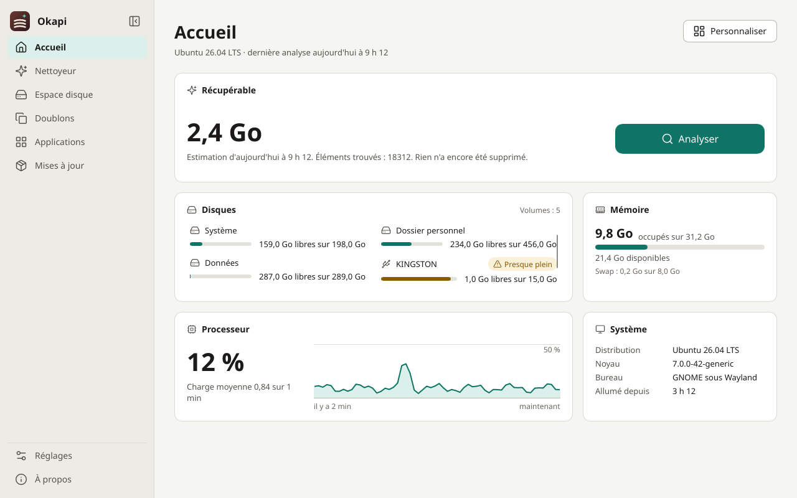
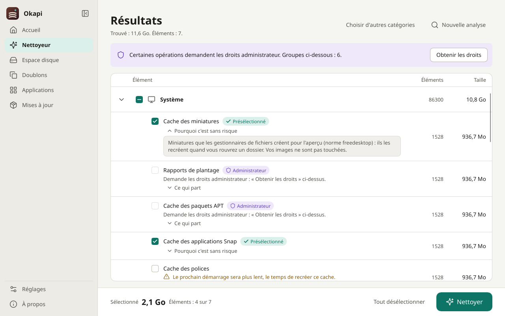
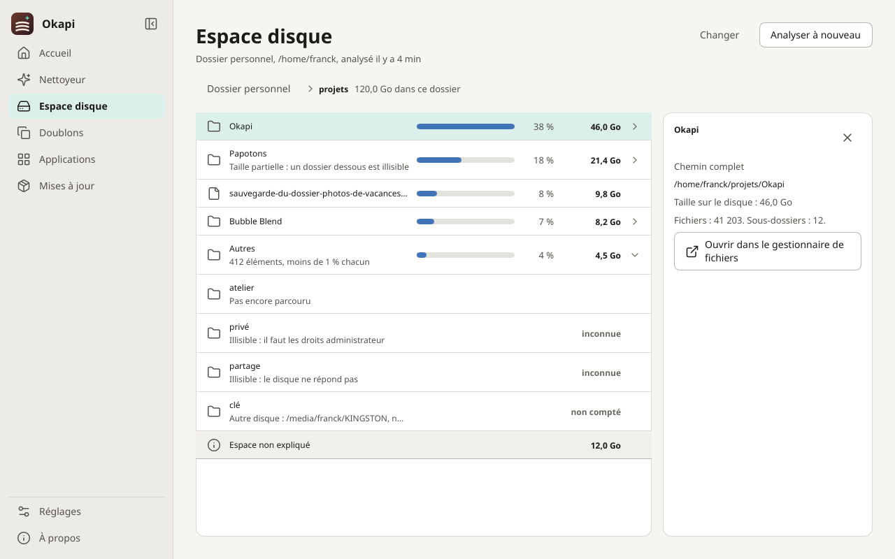
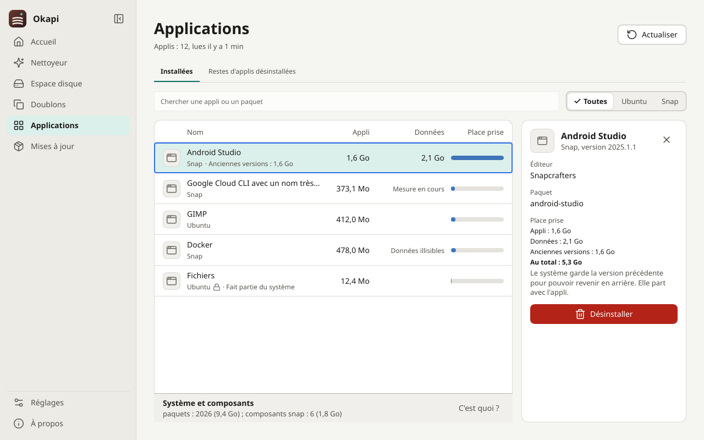
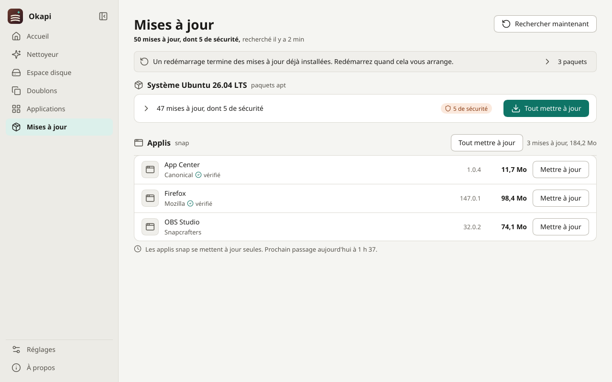

<p align="center">
  
</p>

<h1 align="center">Okapi</h1>

<p align="center">
  <strong>A native system cleaner and maintenance tool for the Linux desktop, written in Rust.</strong><br>
  No Electron, no cloud, no app running as root.
</p>

<p align="center">
  <a href="LICENSE"></a>
  
  
  <a href="https://slint.dev"></a>
  
</p>

<p align="center">
  <strong>English</strong> · <a href="README.fr.md">Français</a>
</p>

<p align="center">
  <picture>
    <source media="(prefers-color-scheme: dark)" srcset="assets/screenshots/home-dark.png">
    
  </picture>
</p>

> [!WARNING]
> Okapi is in early development (version 0.1.0). There is no packaged release yet: you build it from source, and it runs on Linux only for now. It is a tool that deletes files, so read what it shows you before you confirm.

## What it does

| | |
|---|---|
| **Cleaner** | Finds what applications leave behind (caches, logs, temporary files, crash reports) for the system, Chromium and Firefox based browsers, dozens of desktop apps and developer tools, games and GPU shader caches. Every group says why it is safe to remove. |
| **Dashboard** | A home screen you arrange yourself: reclaimable space, disks, memory, processor, system. Widgets move with the mouse or the keyboard. |
| **Disk usage** | Shows what takes up space, folder by folder, and opens any of them in your file manager. |
| **Duplicates** | Finds files with identical content (BLAKE3) and moves the copies you pick to the trash. The last copy of a file never leaves. |
| **Applications** | Lists installed apps (deb, snap, flatpak) with the space each one really takes, uninstalls them, and finds the folders that uninstalled apps left behind. |
| **Updates** | Shows pending apt and snap updates, with security updates flagged, and installs them. |
| **Command line** | `okapi` scans and cleans from a terminal or a script, with JSON output and meaningful exit codes. |

The interface is available in French and English, in a light and a dark theme, and is designed to be used with the keyboard and a screen reader.

## Screenshots

The interface below is shown in French, its source language.

| Cleaner | Disk usage |
|---|---|
|  |  |

| Applications | Updates |
|---|---|
|  |  |

## Safe by design

A cleaner is only useful if you can trust it. These rules are enforced in the code and covered by tests:

- **Identifiers, never paths.** The interface and the CLI never send a path to delete. They send identifiers from the last scan, and only the library that produced that scan can turn them back into files.
- **Checked again at the last moment.** The age of every entry, descendants included, is read again right before it is removed. Something that came back into use since the scan stays.
- **Symbolic links are never followed**, neither by the scan nor by the deletion. Cleaning walks down from a known root through file descriptors, so a folder swapped for a link in the meantime leads nowhere.
- **Your important folders can never be a target.** A deletion root is never your home, your configuration folder or any of their parents. This is checked by file identity, not by comparing names.
- **Nothing risky is ticked for you.** Cleanups that slow the next start (performance caches) and maintenance operations are always left unchecked.
- **Your own files go to the trash.** Duplicates and application leftovers are moved to the trash, never deleted, after checking that the file is still the one that was analysed. Only caches and other regenerable files found by the cleaner are removed for good, and the confirmation says so.
- **Rules are data.** A cleaning rule can name folders and patterns, never a command, a program or an argument.
- **Okapi never runs as root.** Cleaning system locations goes through a tiny helper started with `pkexec` under a polkit policy. It accepts a closed list of operations and redoes the analysis itself instead of trusting what it is told. Installing updates and uninstalling apps is delegated to PackageKit, snapd and Flatpak's system helper: Okapi never sees a password.
- **Everything stays on your machine.** No account, no cloud, no telemetry. The binaries embed no HTTP client: Okapi only talks to local services (D-Bus, the snapd socket).

On the code side, `unsafe` is denied across the whole workspace and Clippy's pedantic lints are the norm.

## Getting started

### Requirements

- Linux. Okapi is developed and tested on Ubuntu with GNOME under Wayland. Other distributions are untested so far.
- Rust 1.99 or newer.
- A C toolchain, `pkg-config` and the fontconfig development files. On Ubuntu:

```bash
sudo apt install build-essential pkg-config libfontconfig-dev
```

The Applications and Updates screens rely on PackageKit and snapd when they are present. Everything else works without them.

### Build and run

```bash
git clone https://github.com/Cryborg/okapi.git
```

```bash
cd okapi
```

```bash
cargo run --release -p okapi-app
```

### Optional: cleaning system locations

Some groups (the APT package cache, crash reports...) belong to the administrator. To unlock them, install the helper and its polkit policy. Run the script as yourself: it builds the helper, then asks `sudo` for two file copies only.

```bash
packaging/linux/install-helper.sh
```

`packaging/linux/uninstall-helper.sh` removes both files.

### Optional: launcher and icon

This adds Okapi to your applications menu, for your user only. The launcher points at the development build in `target/debug`.

```bash
packaging/linux/install-desktop-entry.sh
```

## Command line

Build the `okapi` binary once:

```bash
cargo build --release -p okapi
```

Scan and show what could be removed, without touching anything:

```bash
./target/release/okapi
```

Clean the preselected groups (never the cache resets, never what needs the administrator):

```bash
./target/release/okapi --clean
```

Scan only browsers and apps, as JSON, for a script:

```bash
./target/release/okapi --json --browsers --apps
```

`okapi --help` lists every option: categories (`--system`, `--browsers`, `--apps`, `--gaming`, `--gpu`), `--exclude`, `--min-age`, `--verbose`, `--quiet`, and the exit codes.

Okapi reads its settings from `~/.config/okapi/settings.json` and keeps its history and logs under `~/.local/state/okapi/`.

## Project layout

A Cargo workspace where the interface and the CLI are thin shells over the libraries:

| Crate | Role |
|---|---|
| `okapi-rules` | Cleaning rules as data: types, variables, validation, translated texts. |
| `okapi-platform` | Operating system traits (paths, elevation, trash...), one module per OS. |
| `okapi-engine` | Scan, safe cleaning, receipts, progress and cancellation. |
| `okapi-store` | Settings, dashboard layout, history, logs, with atomic writes. |
| `okapi-tools` | One module per tool: disk usage, duplicates, applications, updates, monitoring. |
| `okapi-helper` | The privileged binary started through `pkexec`, with its closed list of operations. |
| `okapi` | The command line. |
| `okapi-app` | The desktop interface, built with [Slint](https://slint.dev). |

## Roadmap

Ideas being worked on, in no promised order:

- Large files, empty folders, startup programs and systemd services
- A history screen for past cleanups
- Scheduled cleanups
- Disk health
- Windows, then macOS

## Contributing

Bug reports and ideas are welcome in the [issues](https://github.com/Cryborg/okapi/issues), in English or in French. If Okapi offered to remove something it should have kept, that is the most valuable report you can make.

Before opening a pull request:

```bash
cargo test --workspace
```

```bash
cargo clippy --workspace --all-targets -- -D warnings
```

```bash
cargo fmt --all --check
```

Code and identifiers are in English. Interface texts are written in French first, then translated to English.

## Credits

Okapi is inspired by [Kudu](https://github.com/adventdevinc/kudu) (MIT), whose cleaning rules it reuses and adapts. See [THIRD_PARTY_NOTICES](THIRD_PARTY_NOTICES) for the details. Okapi is an independent project and is not affiliated with Kudu.

The interface is made with [Slint](https://slint.dev).

## License

[MIT](LICENSE)
